# MetaHuman のリグで VRoid モデルを動かす 使い方マニュアル（日本語）

このマニュアルは、このリポジトリのスクリプトを使って、MetaHuman Animator で作った顔のアニメーションと、Mixamo／UE マネキンの体の動きを、VRoid（VRM）モデルに当てる手順をまとめたものです。
画面は、このリポジトリを clone した新規の UE 5.8 プロジェクトで、実際にコマンドを実行して撮影しました。

- **PowerShell を使わずに、ダブルクリックだけで進めたい方は「3. 準備」と「4. かんたん手順」を読んでください。**
- 流れを1枚で知りたい方は「2. 全体の流れ」を読んでください。
- 値を変えたい方は「6. 調整できる値」を読んでください。
- うまくいかないときは「7. よくある失敗」を読んでください。

---

## 1. 先に知っておく用語

| 用語 | 意味 |
|---|---|
| VRM | VRoid Studio が書き出す、人型キャラクターのファイル形式 |
| VRM4U | VRM を UE に取り込むための、無料のプラグイン（MIT ライセンス） |
| `Fcl_*` | VRoid 標準の表情（モーフ）の名前。口は `Fcl_MTH_A`（あ）など、約56個あります |
| MetaHuman Animator | 動画から MetaHuman の顔のアニメーションを作る、UE の機能 |
| Performance | MetaHuman Animator が解析した結果のアセット。顔のコントロールの時間変化が入っています |
| カーブ | 時間ごとの値の列。表情の強さ（0〜1）を表します |
| AnimSequence | UE のアニメーションのアセット。骨の動きと、カーブが入ります |
| リターゲット | ある骨格の動きを、別の骨格に当てること |
| IK | 手や足の位置から、腕や脚の曲がりを計算する方法 |
| スプリングボーン | 髪や服を、ばね仕掛けで揺らす VRM の仕組み |
| Level Sequence | UE のシーケンス。カメラとアニメを決めて、再生や書き出しに使います |
| `config.json` | プロジェクト固有の名前を書く設定ファイル。スクリプトはこれを読みます |

---

## 2. 全体の流れ

| 順 | やること | 使うもの | 結果 |
|---|---|---|---|
| 1 | VRM を UE に取り込む | UE のエディタ（VRM4U） | `SK_*`、`VM_*_VrmMeta` など |
| 2 | 設定ファイルを書く | `config.json` | 名前の対応 |
| 3 | 顔カーブを書き出す | `ue_export_face_curves.py` | `mh_curves.json` |
| 4 | VRoid の表情に変換する | `apply_mapping.py` | `vrm_curves.json` |
| 5 | AnimSequence にする | `ue_bake_vrm_anim.py` | `AS_vrm_face` |
| 6 | 頭の回転を入れる | `ue_head_rotation.py` | `AS_vrm_face_Head` |
| 7 | 揺れを調整する | `ue_spring_params.py` | VRM メタの値 |
| 8 | 体の動きを当てる | `ue_mixamo_*.py`／`ue_body_retarget_mannequin.py` | `VRM_*` |
| 9 | 足と手を補正する | `ue_ground_fix_*.py`、`ue_body_fix.py` | `VRM_*_Fixed` |
| 10 | 確認する | `ue_make_*.py` | `LS_Demo`、PNG の連番 |

顔（順 3〜6）と体（順 8〜9）は、別々に作って、最後に1つのアニメにまとめます。

---

## 3. 準備

### 3-0. 必要なもの

- Unreal Engine 5.8（MetaHuman プラグインを有効にする）
- VRM4U（5.8 用のビルド）を、プロジェクトの `Plugins` に置く
- VRoid Studio で作った VRM（標準の `Fcl_*` 表情を持つもの）
- MetaHuman Animator で、Process まで終えた Performance（顔カーブを使う場合）
- Mixamo の FBX（`T-Pose.fbx` と、動かしたい動き）。Mixamo の規約に従って、ご自身で入手してください

**PowerShell、Python、Git は、必須ではありません。** `run_all.bat` と、UE のエディタのメニューだけで、全手順を実行できます。
Python 3 と Git は、次の場合にだけ使います。
- Python 3: UE の外で `apply_mapping.py` などを実行したいとき（numpy は不要です）
- Git: ZIP の代わりに `git clone` で取得したいとき

> PowerShell を使いたい場合も、Windows 10／11 には「Windows PowerShell 5.1」が、最初から入っています。インストールは不要です。

UE 5.7 は未確認です。

### 3-1. ダウンロードして、置く

1. https://github.com/NzuYoshikawa/vroid-metahuman-facedrive を開く
2. 緑色の **Code** ボタンをクリックする
3. **Download ZIP** をクリックする（直接のリンク: `https://github.com/NzuYoshikawa/vroid-metahuman-facedrive/archive/refs/heads/main.zip`、約 16 MB）

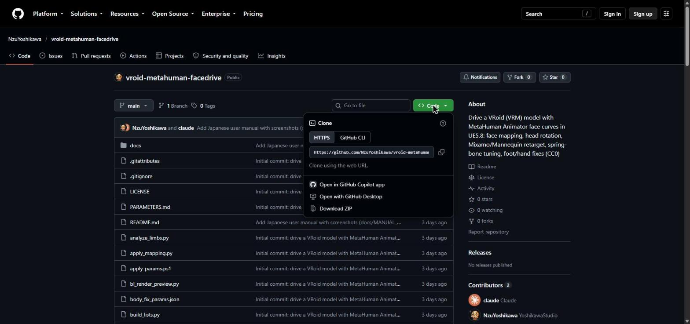
4. `C:\FaceDrive\` フォルダを作る
5. ZIP を右クリックして **すべて展開** を選び、展開先に `C:\FaceDrive\` を指定する
6. `C:\FaceDriveroid-metahuman-facedrive-main\` ができる

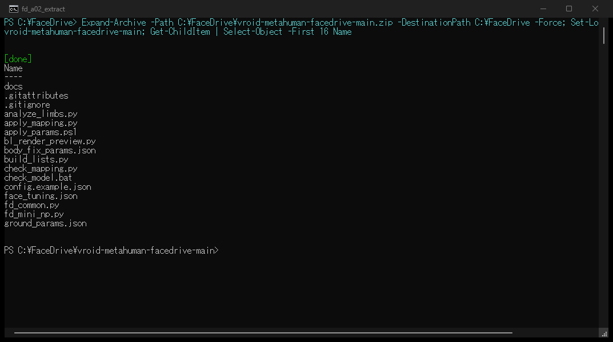

- UE のプロジェクトの中（`Content` や `Plugins`）には置きません。別のフォルダから UE を呼び出す形です。
- パスに、日本語と空白を含めないでください（日本語を含むパスは未確認です）。
- `Program Files` の中には置かないでください（書き込みできないことがあります）。
- スクリプトは、同じフォルダの `config.json` を読みます。スクリプトだけを別の場所へ移さないでください。
- Mixamo の FBX は、別のフォルダ（例: `C:\FaceDrive\Mixamo`）に置きます。

`git clone` で取得する場合は、次のコマンドを使います。

```
git clone https://github.com/NzuYoshikawa/vroid-metahuman-facedrive
```

### 3-2. VRM を取り込む

2通りあります。

**方法 A: スクリプトで取り込む（ダイアログなし）。** `config.json` に `"vrm"` と `"vroid_dir"` を書くと、`ue_import_vrm.py`（`run_all.bat` の最初の手順）が、取り込みと、`config.json` の名前の欄の書き込みまで行います。
取り込みが不完全になったとき（アセットが揃わない、表情が欠ける）は、自動でやり直します（最大 3 回）。

**方法 B: エディタで取り込む。** エディタを通常起動して、Content Browser の **Import** から VRM を選びます。

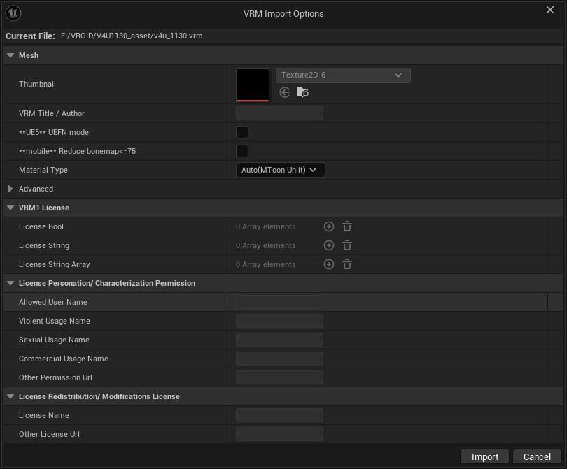

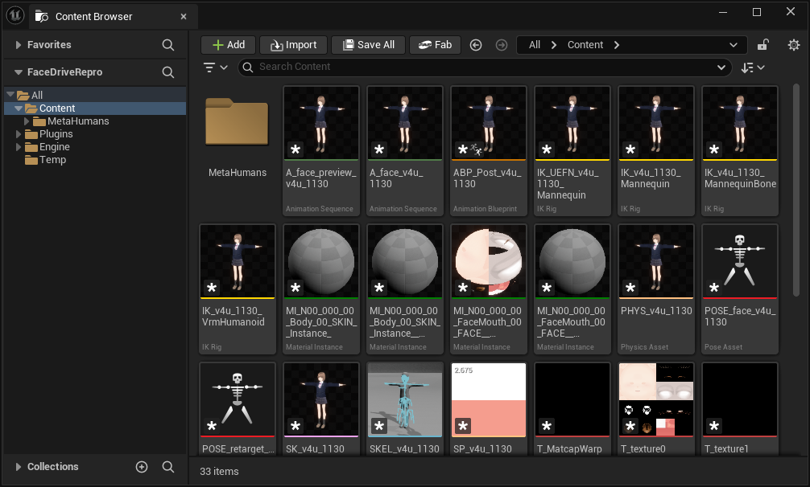

> コマンドラインの自動実行（`-unattended`）では、ダイアログが出て、方法 B は中断します。方法 A は、ダイアログを使わない取り込みの機能（VRM4U の `ImportVRMFileWithOptions`）を呼ぶため、中断しません。

### 3-3. `config.json` を書く

`config.example.json` を `config.json` にコピーして、書き換えます。
方法 A で取り込んだ場合、`mesh` から `face_pose_anim` までは、自動で書き込まれます。自分で書くのは、`vrm`、`vroid_dir`、`mixamo_dir`、`performance` です。

> JSON では、パスの区切り `\` を、`/` にするか、`\\` と2つ重ねて書きます（例: `"E:/Models/my.vrm"` または `"E:\\Models\\my.vrm"`）。`/` を使うと、間違えにくくなります。

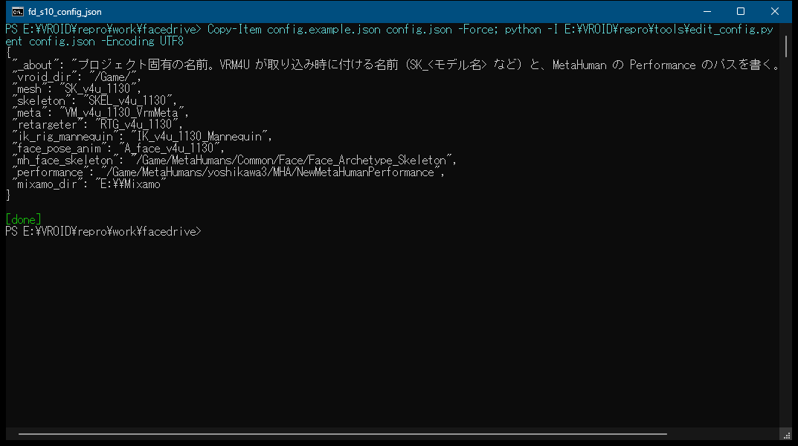

| 項目 | 意味 | 例 |
|---|---|---|
| `vrm` | 取り込む VRM ファイルのパス（方法 A） | `C:\Models\my.vrm` |
| `vroid_dir` | VRM を取り込む場所 | `/Game/Model/` |
| `mesh` | スケルタルメッシュの名前 | `SK_v4u_1130` |
| `skeleton` | スケルトンの名前 | `SKEL_v4u_1130` |
| `meta` | VRM メタの名前（揺れの値が入っています） | `VM_v4u_1130_VrmMeta` |
| `retargeter` | VRM4U が作るリターゲッタの名前（無ければ自動で作ります） | `RTG_v4u_1130` |
| `ik_rig_mannequin` | VRM4U が作るマネキン形式の IK Rig | `IK_v4u_1130_Mannequin` |
| `face_pose_anim` | 表情のポーズのアニメ | `A_face_v4u_1130` |
| `mh_face_skeleton` | MetaHuman の顔のスケルトン | `/Game/MetaHumans/Common/Face/Face_Archetype_Skeleton` |
| `performance` | Performance アセットのパス | `/Game/MetaHumans/<名前>/MHA/<アセット>` |
| `mixamo_dir` | Mixamo の FBX を置いたフォルダ | `C:\FaceDrive\Mixamo` |
| `env` | 各スクリプトの環境変数（`FD_*`）の既定値（任意） | `{"FD_HEAD_T0": "8.0"}` |
| `steps` | `ue_run_all.py` で実行する手順を絞る（任意） | `["check", "spring"]` |

---

## 4. かんたん手順（ダブルクリックだけ）

1. `settings.bat` を、メモ帳で開く
2. `UE_DIR`（UE のフォルダ）と、`PROJECT`（`.uproject` のパス）を書いて、保存する

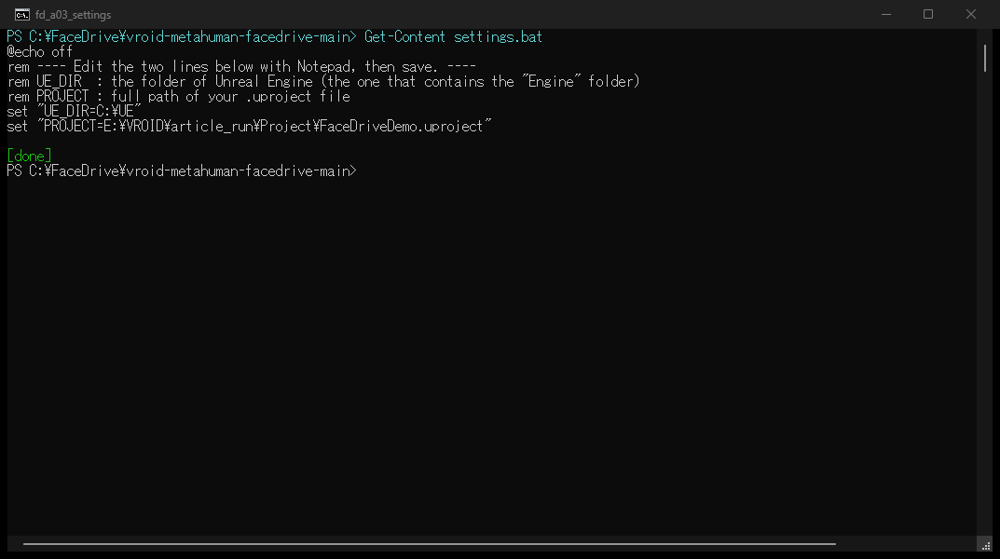
3. `config.json` に、`vrm`、`vroid_dir`、（あれば）`mixamo_dir` と `performance` を書く

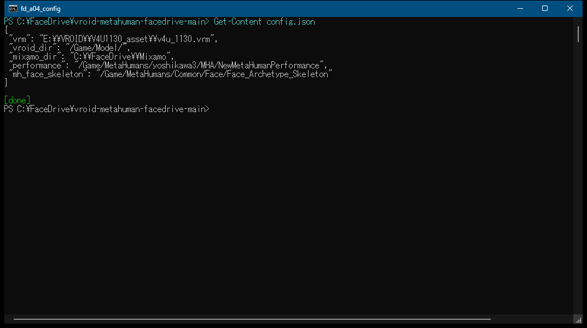
4. **`run_all.bat` をダブルクリックする**

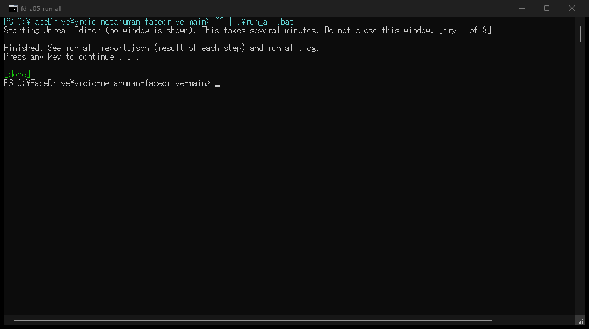
5. UE のエディタが、画面に表示されないまま裏で動き、全手順を順に実行して、自動で閉じる（モデルや動きの数によって、10〜30分）
6. 結果は `run_all_report.json`（手順ごとの成功・失敗・飛ばした理由）と、`run_all.log` に出る

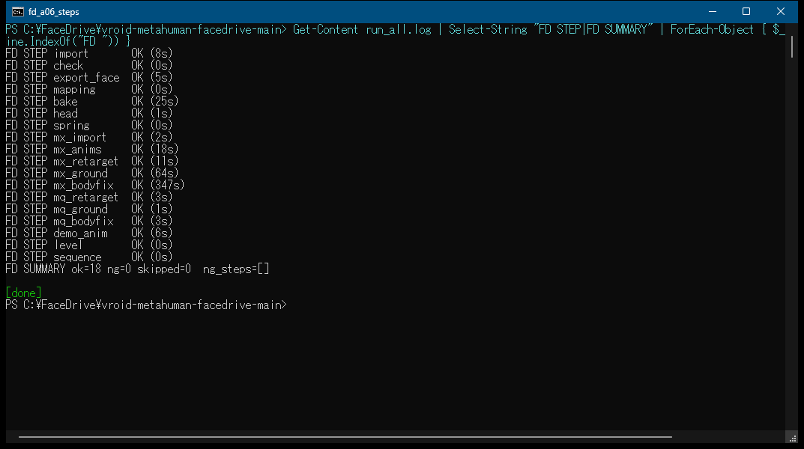

エディタが途中で落ちたときは、`run_all.bat` が自動でやり直します（最大 3 回）。
手順の途中で止まった場合は、`run_all.log` の「FD STEP」の行で、どの手順かが分かります。

エディタを自分で開いて実行する場合は、メニューの **Tools** → **Execute Python Script...** で `ue_run_all.py` を選びます。
1つの手順だけを実行する場合は、同じメニューで、その手順のスクリプトを選びます（下の 4-1 以降）。

モデルを取り込んだら、先に **`check_model.bat`** をダブルクリックして、事前チェックを実行してください。
高さ、骨の名前の対応、表情の数、揺れ物の構成を調べ、**検証済みの範囲から外れる点があれば警告**します。結果は `model_report.json` に出ます。

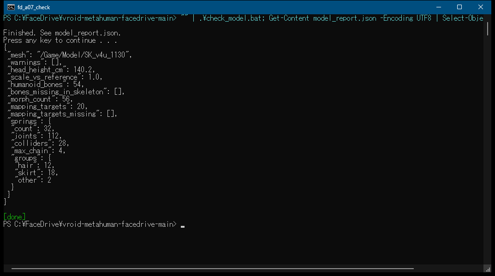

## 5. 手順（1つずつ実行する場合）

UE のスクリプトは、すべて次の形で実行します（`<スクリプト>` を差し替えます）。PowerShell で、`C:\FaceDrive\vroid-metahuman-facedrive-main\` から実行してください（PowerShell を使わない場合は、前の「かんたん手順」を使います）。

```
& "C:\Program Files\Epic Games\UE_5.8\Engine\Binaries\Win64\UnrealEditor-Cmd.exe" <プロジェクト>.uproject -run=pythonscript -script="$PWD\<スクリプト>" -unattended -nosplash -stdout -FullStdOutLogOutput
```

### 5-1. 名前の一覧を作る（初回のみ）

```
python -I build_lists.py "C:\Program Files\Epic Games\UE_5.8" <モデル>.vrm
```

MetaHuman のコントロール 251個と、VRM のモーフ 57個の一覧ができます。

### 5-2. 顔カーブを書き出す

スクリプト: `ue_export_face_curves.py`

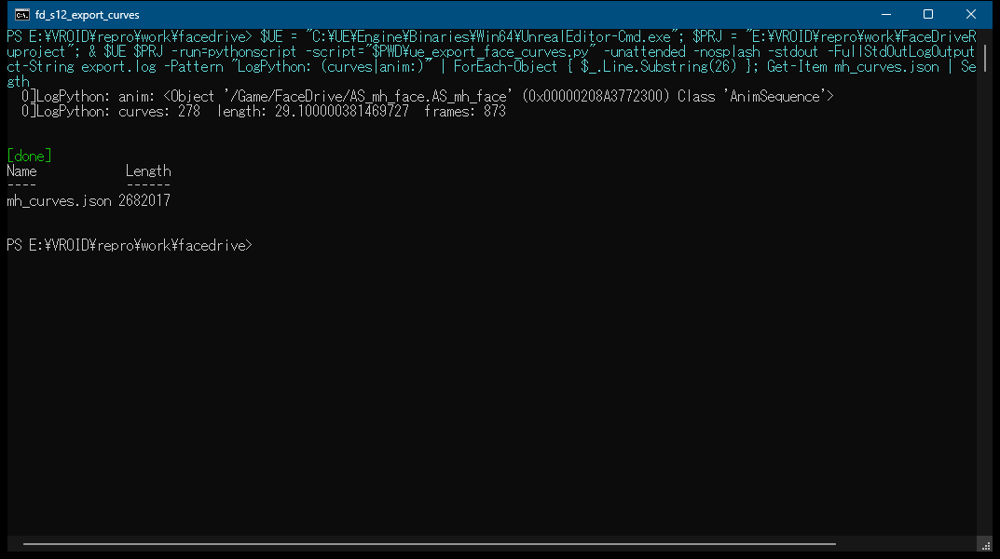

### 5-3. VRoid の表情に変換する

```
python -I apply_mapping.py mh_curves.json mapping_v2.json vrm_curves.json 30
python -I check_mapping.py mapping_v2.json
```

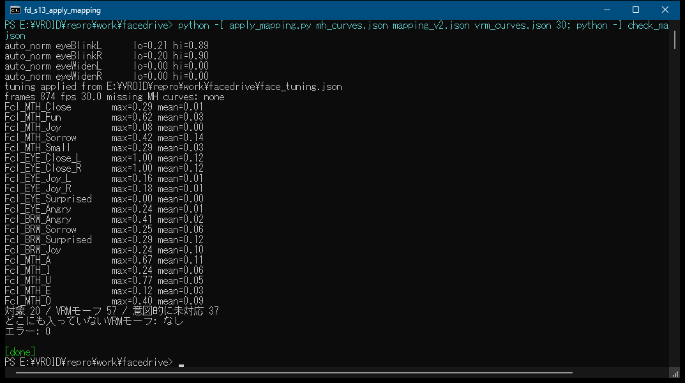

### 5-4. AnimSequence にする

スクリプト: `ue_bake_vrm_anim.py`


### 5-5. 頭の回転を入れる

```
$env:FD_HEAD_ANIM = "/Game/FaceDrive/AS_vrm_face"
$env:FD_HEAD_OUT  = "/Game/FaceDrive/AS_vrm_face_Head"
$env:FD_HEAD_T0   = "0"
```

スクリプト: `ue_head_rotation.py`


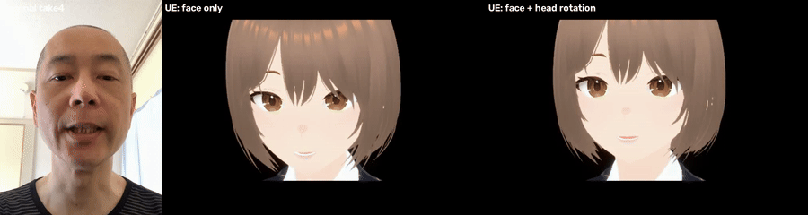

### 5-6. 揺れを調整する

`spring_params.json` の値を書いて、`ue_spring_params.py` を実行します。

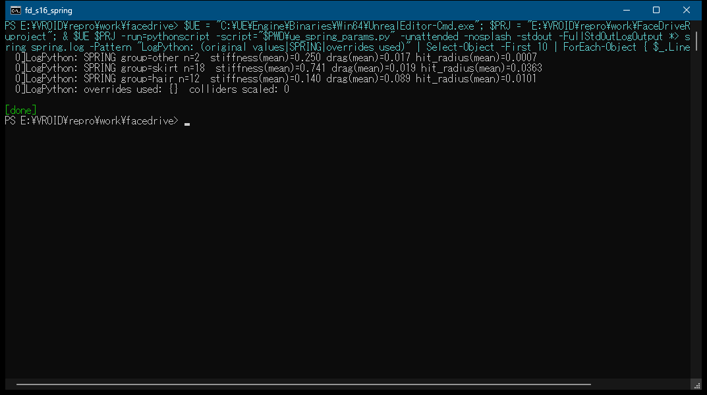

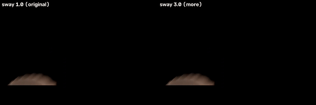

### 5-7. Mixamo の動きを取り込む

1. `mixamo_dir` に、`T-Pose.fbx` と動きの FBX を置く
2. `ue_mixamo_import.py` を実行する（T-Pose とスケルトンができます）

   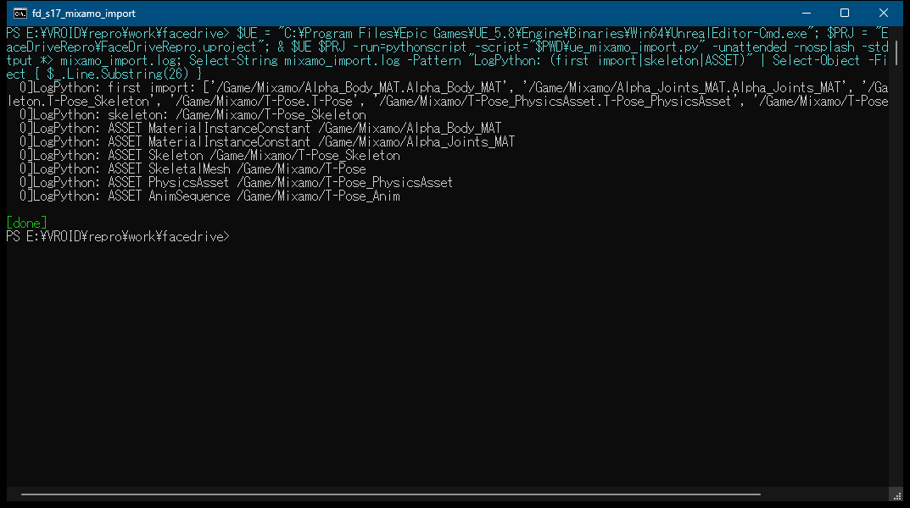

3. 動きの FBX を取り込む。このときだけ、`-ExecCmds` を付けます

```
& "<UnrealEditor-Cmd.exe>" <プロジェクト>.uproject -ExecCmds="Interchange.FeatureFlags.Import.FBX 0" -run=pythonscript -script="$PWD\ue_mixamo_anims.py" -unattended -nosplash -stdout -FullStdOutLogOutput
```

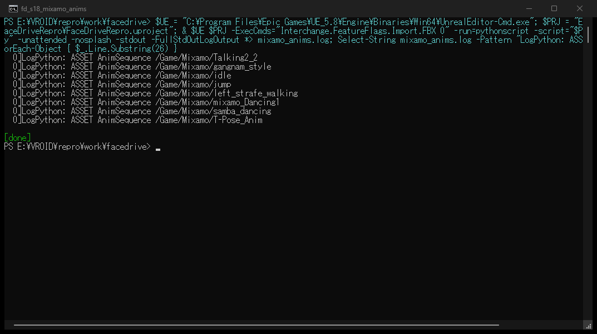

### 5-8. VRoid にリターゲットする

スクリプト: `ue_mixamo_retarget.py`


UE マネキンの動きを使う場合は、`ue_body_retarget_mannequin.py` を実行します。

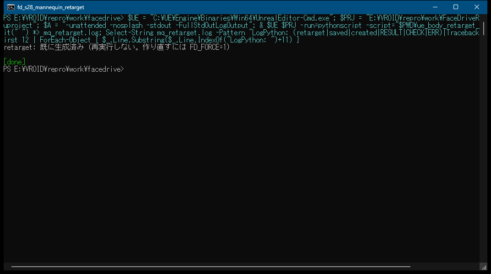

### 5-9. 足の沈みと手の貫通を補正する

| 動きの種類 | 接地補正 | 手足の補正 |
|---|---|---|
| Mixamo | `ue_ground_fix_mixamo.py` | `FD_SET=mixamo` で `ue_body_fix.py` |
| UE マネキン | `ue_ground_fix_mannequin.py` | `FD_SET=mannequin` で `ue_body_fix.py` |

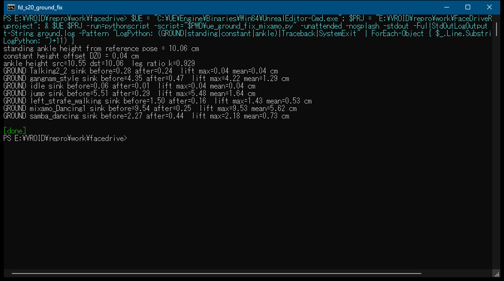

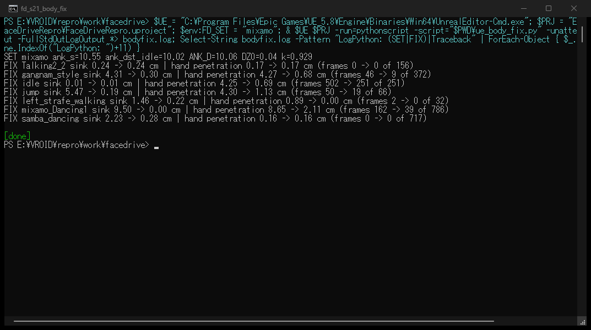

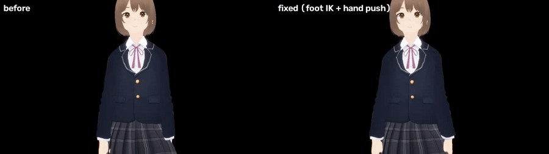

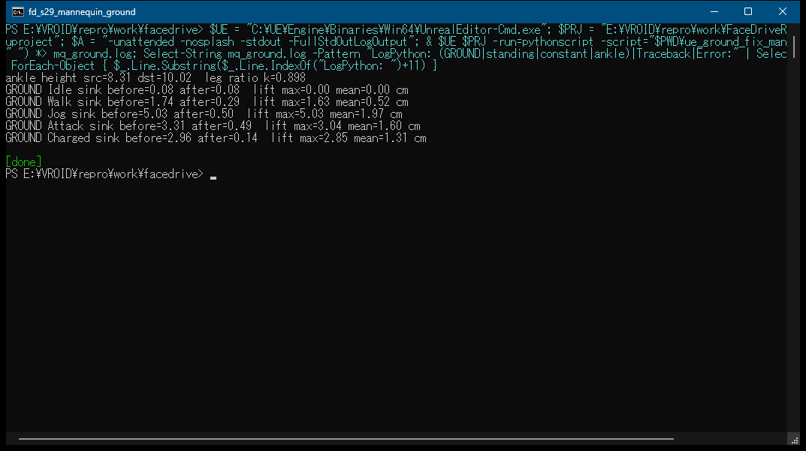

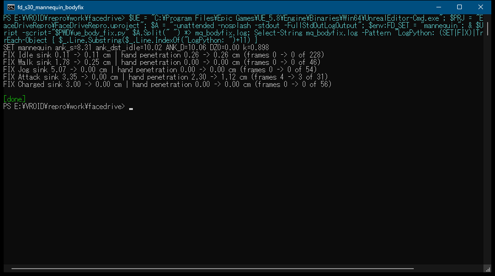

### 5-10. 確認する

1. 体と顔を、1つのアニメにまとめる（`ue_make_demo_anim.py`。`FD_BODY`、`FD_DEMO`、`FD_T0` で指定）

   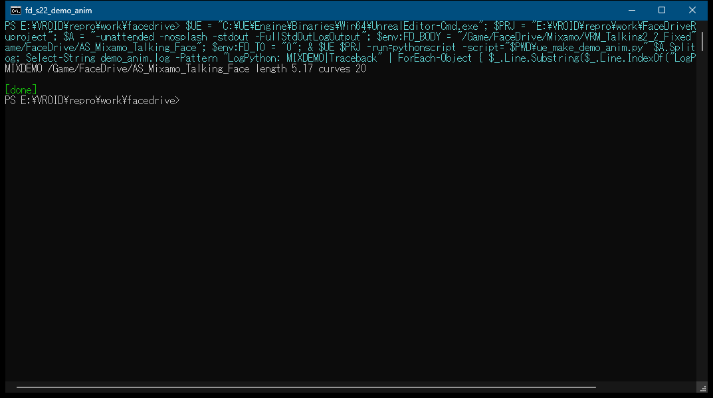

2. `ue_make_demo_level.py` で、確認用のレベル `Demo_VRoid` を作る
3. `ue_make_sequence.py` で、Level Sequence を作る（`FD_SEQ_NAME`、`FD_ANIM`、`FD_REPEAT`）
4. エディタで `Demo_VRoid` を開く

   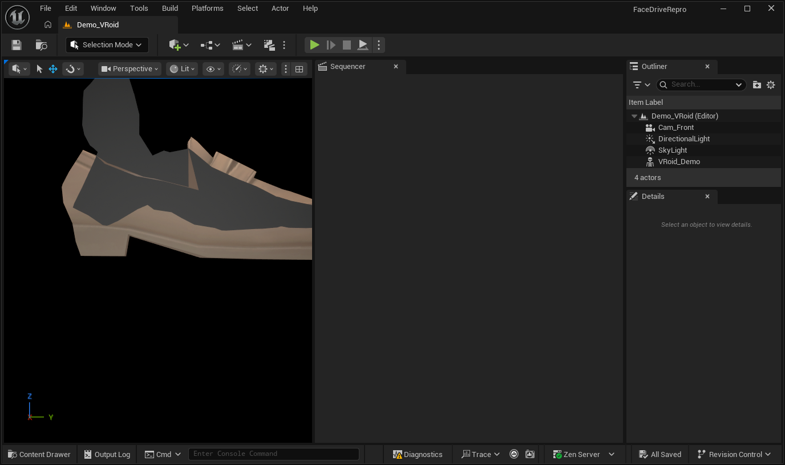

5. 画像として書き出す

```
UnrealEditor.exe <プロジェクト>.uproject /Game/FaceDrive/Demo_VRoid -game -windowed -ResX=1280 -ResY=720 -ForceRes -NoLoadingScreen -NoTextureStreaming -MovieSceneCaptureType=/Script/MovieSceneCapture.AutomatedLevelSequenceCapture -LevelSequence=/Game/FaceDrive/LS_Demo.LS_Demo -MovieFolder=<出力先> -MovieName=vroid -MovieFormat=PNG -MovieFrameRate=30 -NoSplash -unattended
```

> `-NoTextureStreaming` を付けないと、書き出しが始まらず、フレームが1枚も出ません。
> Movie Render Queue は、PIE がすぐ終わるため使えませんでした。

---

## 6. 調整できる値

値を直したら、`apply_params.ps1` で反映します（`-Only face`／`spring`／`ground`／`bodyfix`）。反映したあと、UE で Level Sequence を再生して確認します。
`FD_PROJECT` に、`.uproject` のパスを入れておいてください。

### 6-1. 顔の表情（`face_tuning.json`）

| 項目 | 何が変わるか | 上げると／1以外にすると | 既定値 |
|---|---|---|---|
| `expression_gain` | 全表情の強さ | 全体が大きく動く | 1.0 |
| `smooth_frames` | ちらつきの抑え方 | 大きくすると、動きがなめらかになるが、鈍くなる（3 で 3フレーム平均） | 1 |
| `morphs.<名前>.gain` | その表情だけの強さ | 上げると大きく動く | 1.0 |
| `morphs.<名前>.offset` | その表情の下駄 | 上げると、常にその分だけかかる | 0.0 |
| `morphs.<名前>.min`／`max` | その表情の下限・上限 | `max` を下げると、それ以上は動かない | 0.0／1.0 |

- 口が小さい → `Fcl_MTH_A` などの `gain` を上げる。動きすぎる → 下げる。
- 目の閉じ方 → `Fcl_EYE_Close_L／R` の `gain`、または `mapping_v2.json` の `auto_norm`。
- 変換の対応そのものを変える場合は、`mapping_v2.json` の `targets`（重みの和）、`visemes`（口の開き×あ・い・う・え・お の配分）を編集します。

### 6-2. 頭の回転（`head_params.json`）

| 項目 | 何が変わるか | 既定値 |
|---|---|---|
| `enable` | 頭の回転を入れるか | true |
| `nod_gain` | うなずきの大きさ | 1.0 |
| `turn_gain` | 左右の向きの大きさ | 1.0 |
| `nod_sign`／`turn_sign` | 向きの反転（1 か −1） | 1 |
| `neck_share` | 回転のうち、首に配る割合（0 なら頭だけ） | 0.3 |
| `max_deg` | 回転の上限（度） | 25.0 |

### 6-3. 髪・服の揺れ（`spring_params.json`）

値は、VRM の元の値に対する倍率です（1.0 が元のまま）。元の値は `spring_params_original.json` に保存されるので、何度実行しても累積しません。

| 項目 | 何が変わるか | 上げると | 下げると | 既定値 |
|---|---|---|---|---|
| `sway` | 揺れやすさ（全体） | 大きく揺れる | 揺れが小さい | 3.0 |
| `groups.<名前>.sway` | グループごとの揺れやすさ | 大きく揺れる | 揺れが小さい | 髪 1.5／スカート 0.3／その他 1.0 |
| `stiffness_scale` | 戻る力 | 元の形に戻りやすい | 戻りにくい | 1.0 |
| `drag_scale` | 空気抵抗 | 動きが早く止まる | 長く揺れる | 1.0 |
| `gravity_scale` | 重力 | 下に垂れる | 垂れにくい | 1.0 |
| `hit_radius_scale` | 当たりの半径 | 体に近づきにくい（めり込みと隙間が減る） | 体に近づく | スカート 2.0、他 1.0 |

- グループは、骨名の部分一致で分けます（髪：`Hair`、スカート：`Skirt`／`Coat`／`Cloth`、その他：残り）。
- 個別の揺れ物は、`overrides` に書きます。例: `{"match": "CoatSkirtBack_01", "sway": 0.2, "hit_radius_scale": 2.5}`
- 体のコライダー（球）の半径は、`colliders` に書きます。例: `{"match": "UpperLeg", "radius_scale": 1.2}`

一時的に試すだけなら、次のように指定できます。

```
.\apply_params.ps1 -Only spring -Sway 2.0 -Groups "hair=1.5,skirt=0.3"
```

### 6-4. 接地補正（`ground_params.json`、UE マネキン用）

| 項目 | 何が変わるか | 既定値 |
|---|---|---|
| `strength` | 腰を持ち上げる強さ（0 で補正なし） | 1.0 |
| `smooth_frames` | 補正量の平滑化。大きいと、短い接地が薄まる | 3（Jog は 1） |
| `prevent_sink_only` | true なら、沈みだけを直す | true |
| `sink_tolerance_cm` | この深さまでの沈みは直さない | 0.5 |
| `float_blend` | 浮いた分を、どれだけ直すか（0〜1） | 0.0 |

### 6-5. 足の沈みと手の貫通（`body_fix_params.json`）

| 項目 | 何が変わるか | 既定値 |
|---|---|---|
| `foot_ik` | 足の沈みを、脚の IK で直すか | true |
| `hand_push` | 手の貫通を、押し出しで直すか | true |
| `sink_tolerance_cm` | この深さまでの沈みは直さない | 0.3 |
| `torso_radius_cm`／`thigh_radius_cm`／`head_radius_cm` | 胴・太もも・頭の、手を避ける半径 | 11／8／10 |
| `hand_margin_cm` | 手と体の間に残す余白 | 3.0 |
| `penetration_tolerance_cm` | この深さまでの貫通は直さない | 0.3 |
| `smooth_frames` | 補正量の平滑化 | 3 |
| `strength` | 補正の強さ（0〜1） | 1.0 |
| `per_anim` | 動きごとの上書き | 空 |

例: `"per_anim": {"gangnam_style": {"strength": 0.8, "hand_margin_cm": 2.0}}`

胴・太もも・頭の半径と、手の余白（cm）は、**検証した最初のモデル（頭の骨の高さ 140 cm）での値**です。
スクリプトが、モデルごとの頭の骨の高さに比例して、自動で拡大・縮小します（0.8 倍のモデルなら、半径も 0.8 倍で使います）。`ue_body_fix.py` の実行時に、`FD model head height ... scale vs reference model ...` の行で、倍率を確認できます。

---

## 7. よくある失敗

| 症状 | 原因 | 直し方 |
|---|---|---|
| VRM の取り込みが途中で止まる | `-unattended` では、ダイアログが出る | エディタを通常起動して、Import から取り込む |
| アニメだけの FBX が「nothing to import」になる | UE 5.8 の FBX は、既定で Interchange になる | `-ExecCmds="Interchange.FeatureFlags.Import.FBX 0"` を付けて、`ue_mixamo_anims.py` を実行する |
| 膝や肘が反転して、手足が崩れる | リターゲッタの操作「Run IK Rig」 | スクリプトが自動で無効にします。自分でリターゲッタを作った場合は、無効にする |
| リターゲッタが何も動かさない | 操作の一覧が空 | `add_default_ops()` が必要です（スクリプトは実行済み） |
| 誤差が 25〜45% になる | 目標の IK Rig が、VRM 人型形式になっている | VRM4U が作る、マネキン形式の IK Rig（`ik_rig_mannequin`）を使う |
| 顔だけのアニメで、頭が回らない | 骨のトラックが無い | 現在のスクリプトは、先にトラックを作ります。古い版を使っていないか確認する |
| 画像の書き出しで、フレームが1枚も出ない | テクスチャのストリーミング待ち | `-NoTextureStreaming` を付ける |
| 口の位置が、あごに下がる | `Fcl_MTH_Up`／`Fcl_MTH_Down` を使っている | 使わない（`mapping_v2.json` では、使っていません） |
| 映像と表情がずれて見える | 別のテイクの映像と比べている | Performance が使った映像を、`footage_capture_data` で確認する |
| `.ps1` が実行できない（「スクリプトの実行が無効」） | Windows の既定では、スクリプトの実行が禁止されている | `powershell -ExecutionPolicy Bypass -File .\apply_params.ps1 -Only spring` のように、その1回だけ許可する。または、`.bat` を使う |
| ZIP から展開したファイルが、ブロックされる | ダウンロードしたファイルに、警告の印が付いている | 展開したフォルダで `Get-ChildItem -Recurse | Unblock-File` を実行する |
| `apply_mapping.py` が numpy で止まる | UE の外の Python に numpy が無い | 現在の版は、numpy が無くても動きます（`fd_mini_np.py`）。古い版なら `python -m pip install numpy` |
| 取り込みの結果が不完全（表情が0個、アセットが足りない） | 取り込み直後の保存が、メッシュのビルドより先になることがある | `ue_import_vrm.py` が、自動でやり直します（最大 3 回）。3 回とも失敗したら、UE を再起動して、もう一度実行する |
| 取り込み先のフォルダを間違えた | `vroid_dir` の書き間違い | `vroid_dir` は、`/Game/` で始め、末尾を `/` にする。取り込み直す |
| `.ps1` が構文エラーになる | Windows PowerShell 5.1 は、BOM なしの UTF-8 を CP932 として読む | `.ps1` は ASCII のみで書く |
| スカートの帯の間に隙間が出る | 揺れを強くしたため | `hit_radius_scale` を 2 倍にする |

---

## 8. 検証済みの範囲と限界

**検証済みのモデル（全手順を新規プロジェクトで通しました）**

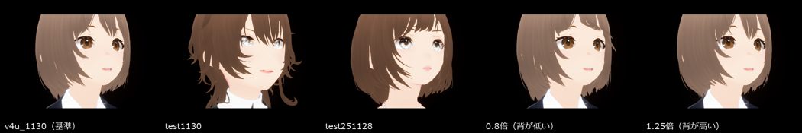

| モデル | 頭の骨の高さ | 揺れ物（房数／関節数） |
|---|---|---|
| `v4u_1130`（最初の基準） | 140 cm | 32／112 |
| `test1130`、`test251128`（VRoid Studio の標準体型） | 142〜143 cm | 22／82、21／82 |
| `v4u_1130` を 0.8 倍に取り込み | 112 cm | 32／112 |
| `v4u_1130` を 1.25 倍に取り込み | 175 cm | 32／112 |

- 足の沈み: 補正後 0.0〜0.3 cm（補正前は最大 11.9 cm）
- 手の貫通: 補正前の最大 10.8 cm が、補正後は最大 2.6 cm（ダンスの一部で残ります）
- 頭の回転、表情、髪の揺れは、全モデルの書き出しで確認

**未検証:** VRoid Studio 以外で作った VRM（骨の名前が違うモデル）、人型でない体型、髪やスカートの無いモデルの揺れの調整。
骨の名前は、VRM の人型ボーン対応表から引く作りですが、実機では VRoid Studio 製のモデルでしか試していません。

**限界**

- 手のずれが、元の動きに対して 12〜20% あります（VRoid の腕の比率の違い）。
- 肘のめり込みと、服（上着の裾など）との干渉は、補正していません。
- 脚を大きく上げる姿勢で、スカートの隙間が残ることがあります。
- 目線は未対応です（VRoid の目に、視線用の形状がありません）。
- UE 5.8 と、VRM4U の 5.8 用ビルドで確認しています。5.7 は未確認です。

## 9. 配布に含まれないもの

MetaHuman のアセット、Mixamo の FBX、VRoid モデル、VRM4U。それぞれ、ご自身で入手し、各ライセンスに従ってください。
このリポジトリのスクリプトと設定は、CC0 です。
